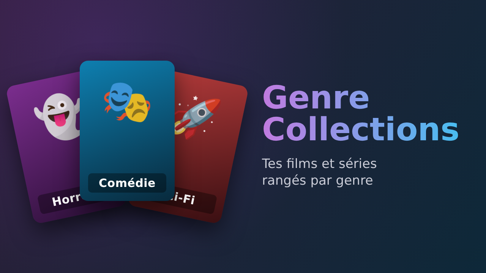

<p align="center"></p>

<h1 align="center">Genre Collections pour Jellyfin</h1>

<p align="center">
  Un accueil façon Netflix : tes films et séries classés par genre et par saga, sans rien casser dans ta bibliothèque.
</p>

<p align="center">
  <a href="../../releases/latest"></a>
  <a href="../../actions/workflows/build.yml"></a>
  
  <a href="LICENSE"></a>
</p>

---

## C'est quoi ?

Genre Collections classe automatiquement tes **films et séries par genre** (Horreur, Comédie, Action, Animation…) et par **saga**, et ajoute sur l'**écran d'accueil** des rangées pour retrouver tes nouveautés et tes contenus sans fouiller dans les dossiers. Un clic sur une série ouvre sa page Jellyfin normale, avec ses saisons et ses épisodes.

- **Classement par genre** : chaque film et chaque série entière (jamais épisode par épisode) va dans **un seul genre**, le plus pertinent, à partir des métadonnées (TMDb, NFO…). Les genres des séries sont harmonisés avec ceux des films (« Action & Adventure » va dans Action et Aventure). Le classement se met à jour tout seul après chaque scan. Les genres ne sont **pas** des collections : ta bibliothèque de séries reste intacte, même avec l'option Jellyfin « Grouper dans les collections ».
- **Sagas de films** : Harry Potter, Hunger Games, Le Seigneur des anneaux… chaque saga a sa collection avec son affiche officielle (TMDb), et une rangée « Films SAGA » en première ligne de l'accueil.
- **Écran d'accueil** : rangées « Nouveaux films », « Séries avec de nouveaux épisodes », « Tous les films », « Toutes les séries », « Genres » et une rangée par genre (aléatoire, derniers ajoutés, mieux notés…).
- **Compatible avec ton thème** : aucun CSS ajouté. Les rangées reprennent le style de ton thème (Abyss, etc.) comme les rangées natives.

Fonctionne avec **Jellyfin 12.x**.

> **Mise à jour depuis la 1.2** : jusqu'ici, les genres étaient des collections Jellyfin. Avec l'option « Grouper dans les collections », les séries disparaissaient de la bibliothèque Séries et il devenait difficile d'ouvrir une saison ou un épisode. Depuis la 1.3, les anciennes collections de genre sont supprimées automatiquement à la première synchronisation, et seules les sagas restent des collections.

## Installation

1. Dans Jellyfin, va dans `Tableau de bord -> Extensions -> Catalogue -> icône engrenage (en haut)` et ajoute un dépôt.
1. Nom du dépôt : `Genre Collections`
1. URL du dépôt :
   ```
   https://raw.githubusercontent.com/JohannDeon/jellyfin-plugin-genre-collections/main/manifest.json
   ```
1. Clique sur **Enregistrer**.
1. Retourne dans **Catalogue** et cherche **Genre Collections**.
1. Clique dessus, puis sur **Installer**.
1. **Redémarre Jellyfin.**

Les mises à jour apparaissent ensuite automatiquement dans le catalogue.

<details>
<summary>Installation manuelle (sans le catalogue)</summary>

1. Télécharge le zip de la [dernière release](../../releases/latest).
2. Décompresse `Jellyfin.Plugin.GenreCollections.dll` dans un dossier `GenreCollections` du répertoire des plugins :

   | Installation | Dossier |
   | --- | --- |
   | Docker | `/config/plugins/GenreCollections/` |
   | Linux (paquet) | `/var/lib/jellyfin/plugins/GenreCollections/` |
   | Windows | `%LOCALAPPDATA%\jellyfin\plugins\GenreCollections\` |
   | macOS | `~/.local/share/jellyfin/plugins/GenreCollections/` |

3. Redémarre Jellyfin.
</details>

## Guide d'utilisation

1. Va dans `Tableau de bord -> Extensions -> Mes extensions -> Genre Collections -> Paramètres`.
1. Choisis ce que tu veux classer : films, séries, ou les deux, en rangées mixtes ou séparées (« Horreur (Films) » / « Horreur (Séries) »).
1. Si besoin, ajoute des **genres exclus** (un par ligne) et des **alias** pour fusionner des genres :
    - `Science Fiction=Science-Fiction` : fusionne deux orthographes
    - `Action & Adventure=Action,Aventure` : découpe un genre de série en deux
1. Dans la partie **Écran d'accueil**, choisis les rangées à afficher, leur position (au-dessus ou en dessous de « Reprendre » / « À suivre ») et les genres à mettre en premier.
1. Clique sur **Enregistrer**.
1. Clique sur **Synchroniser maintenant**.
1. Et voilà ! Les sagas apparaissent dans la bibliothèque **Collections**, et les nouvelles rangées sur l'accueil. Si l'accueil ne change pas, recharge la page (Ctrl + F5).
1. À noter : la tâche **Mettre à jour les collections par genre** est aussi disponible dans `Tableau de bord -> Tâches planifiées`.

## Configuration

### Classement par genre

| Option | Par défaut | Description |
| --- | --- | --- |
| Classer par genre | Activé | Active ou coupe le classement par genre (rangées de l'accueil) |
| Inclure les films / les séries | Activé / Activé | Types de contenus rangés |
| Un seul genre par série | Activé | La série entière va uniquement dans son genre le plus pertinent |
| Un seul genre par film | Activé | Même principe pour les films |
| Priorité des genres | Animation, Documentaire, Horreur, Science-Fiction, Fantastique, Western, Guerre, Familial, Musique, Thriller, Crime, Mystère, Action, Aventure, Comédie, Romance, Histoire, Drame | Choisit le genre le plus pertinent : le premier de la liste que possède le titre (un film « Drame, Horreur » va dans Horreur) |
| Séparer films et séries | Désactivé | Une rangée mixte, ou deux par genre |
| Titre d'une rangée de genre | `{0}` | `{0}` est remplacé par le genre |
| Titre (films / séries séparés) | `{0} (Films)` / `{0} (Séries)` | Utilisés si films et séries sont séparés |
| Nombre minimum de titres par genre | 3 | En dessous, le genre n'a pas de rangée |
| Genres exclus | Téléfilm, TV Movie | Ces genres ne sont jamais utilisés |
| Alias de genres | voir ci-dessous | Fusionne ou découpe des genres |
| Supprimer les sagas devenues inutiles | Activé | Supprime une saga qui n'a plus assez de films |
| Bouton « Supprimer les collections créées » | | Supprime d'un coup les sagas créées par le plugin (pas tes collections faites à la main) |

**Alias de genres.** Une règle par ligne, au format `Source=Cible` ou `Source=Cible1,Cible2`. Voici les règles par défaut :

```
Action & Adventure=Action,Aventure
Sci-Fi & Fantasy=Science-Fiction,Fantastique
Science-Fiction & Fantastique=Science-Fiction,Fantastique
Science Fiction=Science-Fiction
War & Politics=Guerre
Guerre & Politique=Guerre
```

### Sagas de films

| Option | Par défaut | Description |
| --- | --- | --- |
| Créer une collection par saga | Activé | Regroupe les films d'une même saga TMDb (Harry Potter, Hunger Games…). L'affiche officielle de la saga est téléchargée depuis TMDb, sinon celle du premier film est utilisée |
| Nombre minimum de films par saga | 2 | Une saga n'est créée que si au moins ce nombre de ses films sont sur le serveur |
| Rangée « Films SAGA » | Activé | Une affiche par saga, en première ligne de l'accueil |

Les sagas sont reconnues grâce aux métadonnées TMDb des films. Si tu as déjà des collections de sagas (par exemple avec l'option Jellyfin « Ajouter automatiquement à une collection »), elles sont réutilisées et pas dupliquées.

### Écran d'accueil

| Option | Par défaut | Description |
| --- | --- | --- |
| Ajouter des rangées sur l'écran d'accueil | Activé | Active ou coupe toutes les rangées |
| Position | Au-dessus | Au-dessus ou en dessous des rangées Jellyfin (« Reprendre », « À suivre »…) |
| Nouveaux films / Séries avec de nouveaux épisodes | Activé | Rangées des nouveautés |
| Tous les films / Toutes les séries | Activé | Toute la bibliothèque de A à Z ; le titre de la rangée ouvre la liste complète |
| Genres | Activé | Une carte par genre, qui ouvre la page Jellyfin du genre |
| Une rangée par genre | Activé | Une rangée de titres par genre |
| Nombre maximum de rangées de genre | 6 | Limite le nombre de rangées de genre |
| Genres à afficher en premier | vide | Ordre des rangées de genre. Les autres suivent, du plus fourni au moins fourni |
| Ordre dans les rangées de genre | Aléatoire | Aléatoire, derniers ajoutés, mieux notés ou date de sortie |
| Titres par rangée | 20 | Entre 4 et 60 |
| Masquer les titres déjà vus | Désactivé | Dans les rangées de genre uniquement |

## Questions fréquentes

<details>
<summary><b>Les rangées n'apparaissent pas sur l'accueil</b></summary>

Pour afficher les rangées, le plugin ajoute une seule ligne `<script>` dans le fichier `index.html` du client web au démarrage de Jellyfin, et la retire à l'arrêt. Jellyfin doit donc pouvoir écrire dans ce fichier.

- **Docker (image officielle, lancée en root)** : rien à faire.
- **Docker avec `--user`** ou **installation Linux** : donne les droits d'écriture à l'utilisateur de Jellyfin, par exemple :
  ```bash
  sudo chown jellyfin /usr/share/jellyfin/web/index.html
  ```

Si l'écriture est impossible, un avertissement `Cannot write ... index.html` apparaît dans les logs. Les sagas fonctionnent quand même. Pense aussi à vider le cache du navigateur (Ctrl + F5).
</details>

<details>
<summary><b>Un genre n'a pas de rangée</b></summary>

Il faut au moins le nombre minimum de titres (3 par défaut), et le genre ne doit pas être dans la liste des exclus. Les genres viennent des métadonnées (TMDb, NFO…). Vérifie-les dans la fiche du film ou de la série.
</details>

<details>
<summary><b>J'ai des doublons comme « Science Fiction » et « Science-Fiction »</b></summary>

Ajoute un alias, par exemple `Science Fiction=Science-Fiction`, puis relance la synchronisation.
</details>

<details>
<summary><b>Est-ce que ça change le style de mon thème (Abyss, etc.) ?</b></summary>

Non. Le plugin n'ajoute aucun CSS. Les rangées reprennent le style de ton thème.
</details>

<details>
<summary><b>Est-ce que mes collections faites à la main sont touchées ?</b></summary>

Non. Le plugin ne gère que les sagas qu'il a créées. Elles portent un identifiant interne `GenreCollections`, visible dans l'éditeur de métadonnées.
</details>

## Désinstallation

1. **Tableau de bord → Extensions → Genre Collections → Désinstaller**, puis redémarre Jellyfin. La ligne ajoutée à `index.html` est retirée à l'arrêt du serveur.
2. Les collections de genre restent. Pour les retirer, utilise **avant de désinstaller** le bouton « Supprimer toutes les collections créées » dans les paramètres du plugin.

## Compilation

1. Clone ce dépôt.
1. Installe le [SDK .NET 10](https://dotnet.microsoft.com/download).
1. Compile le plugin :

```sh
dotnet test
dotnet publish Jellyfin.Plugin.GenreCollections -c Release -o artifacts
```

Structure du projet :

```
Jellyfin.Plugin.GenreCollections/
├── Api/             # Endpoints utilisés par l'accueil et la page de config
├── Configuration/   # Options et page de configuration
├── Services/        # Synchronisation des collections, règles de genres, injection du script
├── Tasks/           # Tâche planifiée et tâche après scan
└── Web/             # Script des rangées d'accueil (sans CSS)
tests/               # Tests unitaires
```

## Publication

Les releases sont automatiques. Il suffit de fusionner sur `main`, et GitHub Actions :
- incrémente la version de correctif à partir du dernier tag (pour une version mineure ou majeure, change `version` dans `build.yaml`) ;
- compile le plugin avec ce numéro de version ;
- crée une release GitHub avec le zip ;
- met à jour `manifest.json` sur `main`, pour que la nouvelle version apparaisse dans le catalogue Jellyfin.

## Licence

[GPL-3.0](LICENSE), comme le modèle de plugin Jellyfin.
